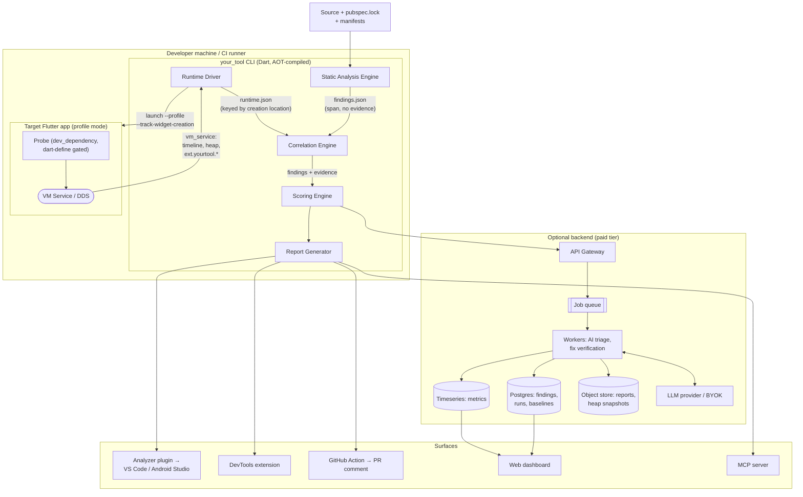
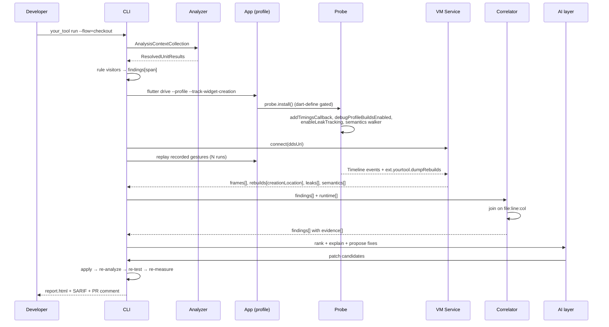
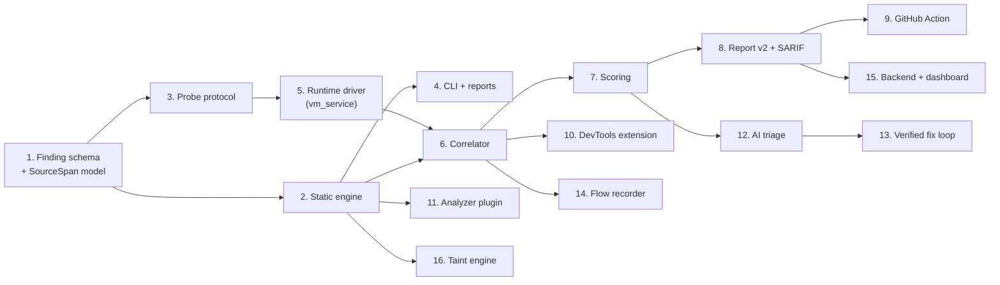
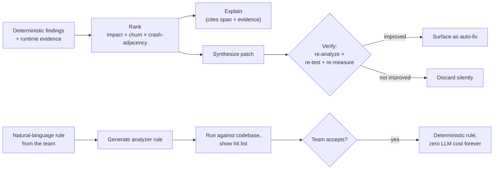

# Lighthouse for Flutter — Implementation Blueprint & Critical Review

*Version 2. Builds on the 8 Aug 2026 evaluation document. Corrections to that document are marked ⚠️.*

---

## 0. What changed since the last document

Three corrections to my own prior research, because you asked for honesty rather than consistency:

⚠️ **Mutation testing for Dart is not an open gap.** I said "no mature implementation." Two exist: `mutation_test` (domohuhn, on pub.dev, XML-configured, supports lcov-driven mutant pruning and incremental git-diff runs) and `dart_mutant` (Nimblesite, `dartmutant.dev`, tree-sitter AST mutations, parallel execution, auto-excludes `*.g.dart`/`*.freezed.dart`, ships CI recipes with `--threshold` gating). Neither is *widely adopted*, but "we built the first Dart mutation tester" is no longer a claim you can make. Demote this from moat to Phase-3 integration — you should **shell out to `dart_mutant` and ingest its report**, not rebuild it.

⚠️ **The Dart/Flutter TAM is smaller than the Flutter marketing ecosystem implies.** Stack Overflow's 2025 survey puts Dart at ~4.2% of professional developers. A 2025 LinkedIn workforce analysis puts TypeScript/React job listings at roughly 8:1 against Flutter/Dart in the US. Cross-platform surveys showing "Flutter 46%" are *usage among cross-platform developers who may report multiple frameworks* — not market share, and frequently mislabelled. Your addressable paying market is realistically **low tens of thousands of teams worldwide**, and DCM is already selling to a meaningful slice of them.

✅ **Unchanged and still the core finding:** nobody joins static findings to runtime evidence in Dart, and no dataflow/taint SAST exists for Dart at all. Those two are real.

---

## 1. Feasibility

### 1.1 Easy — weeks, low risk

| Component | Why it's easy |
|---|---|
| Static rule engine over `package:analyzer` | `AnalysisContextCollection` → `ResolvedUnitResult` gives you a fully type-resolved AST. Writing a visitor-based rule is ~50 lines. |
| Analyzer plugin (IDE squiggles + quick fixes) | `package:analysis_server_plugin` shipped in Dart 3.10 / Flutter 3.38. You register rules, the analysis server does the rest — you get VS Code, Android Studio, and `dart analyze` integration for free. |
| Dependency + supply-chain audit | `pubspec.lock` parse → OSV.dev batch API + pub.dev `/api/packages/<n>/score` + GitHub API for commit recency. Done in a week. `cura` proves it. |
| Coverage ingestion | `flutter test --coverage` → `coverage/lcov.info` → parse. Trivial. |
| Bundle/app size | `flutter build apk --analyze-size` emits a JSON tree DevTools already consumes. Parse it. |
| Manifest/plist/Gradle scanning | Permissions, `usesCleartextTraffic`, `NSAllowsArbitraryLoads`, debug signing, minify/obfuscate flags, exported activities. XML/plist parsing. |
| Frame timing collection | `SchedulerBinding.instance.addTimingsCallback` gives you `FrameTiming` with build duration and raster duration per frame. Cheap, stable, works in profile mode. |
| Report generation (HTML/JSON/SARIF) | Templating. Emit SARIF 2.1.0 from day one — it buys GitHub Code Scanning, Azure DevOps, and most enterprise consoles for free. |
| GitHub Action / Codemagic step | Docker + a CLI invocation. |

### 1.2 Hard — months, high risk, where the product actually lives

| Component | Why it's hard | Mitigation |
|---|---|---|
| **Rebuild attribution** | You must know not just *that* `build()` ran 487 times, but *which widget instance*, *where it's declared in source*, and *what caused it*. `debugProfileBuildsEnabled` emits Timeline events per build with widget names — but names, not source spans, and it's debug-mode-only with meaningful overhead. Mapping a runtime widget back to a `SourceSpan` requires either the Widget Inspector's `WidgetInspectorService` creation-location tracking (`--track-widget-creation`, which injects `_location` into widget constructors) or your own instrumentation. | **Use `--track-widget-creation`.** It's the mechanism the Widget Inspector already relies on to jump-to-source. It gives you file/line/column per widget instance. This is the single most important technical decision in the project. |
| **Stable numbers on CI** | Frame timings vary 15–30% run-to-run on shared CI runners. A metric that flips a PR gate randomly is worse than no metric. | Median-of-N (N≥5), discard warm-up runs, report variance and confidence interval alongside the number, gate on *regression vs baseline* rather than absolute thresholds, and pin the device profile. |
| **Interprocedural taint analysis** | Dart has dynamic dispatch, `dynamic`, `noSuchMethod`, isolates, platform channels, FFI. A sound call graph is impossible; a *useful* one requires hand-written summaries for framework and top-package boundaries. | Build an IFDS/IDE dataflow engine over your own call graph, plus a **model library**: `dio`, `http`, `webview_flutter`, `flutter_inappwebview`, `shared_preferences`, `flutter_secure_storage`, `sqflite`, `url_launcher`, `path_provider`, `go_router`, `app_links`. That model library *is* the moat and the permanent maintenance tax. |
| **Analyzer memory/CPU at scale** | DCM spent 2025 cutting CLI memory from ~4GB to ~350MB on the Flame repo — a 91% reduction that took a year. Whole-program call graph + taint is *strictly more expensive* than what they were optimising. | Incremental analysis keyed on content hashes, per-file summaries persisted to disk, lazy resolution, streaming rather than materialising all units. Design for this on day one; retrofitting is what cost DCM a year. |
| **Golden-flow authoring** | The tool is only as good as the flows it drives. Asking developers to write `integration_test` scripts is a real adoption tax — most Flutter teams have close to zero integration tests. | Ship a recorder: run the app with a `dev_dependency` overlay that records gestures into a replayable script. This is the difference between 5% and 50% activation. **Underrated; possibly your second-biggest product decision.** |
| **Generated code** | `freezed`, `json_serializable`, `riverpod_generator`, `build_runner` output will drown metrics and skew the score. Sonar's own Dart docs warn about exactly this. | Exclude by `.g.dart`/`.freezed.dart` glob *and* by the `// GENERATED CODE` header, configurable. |
| **Correlation semantics** | Joining "frame 47 was slow" to "widget X on line 42" requires a defensible causal model, not a timestamp overlap. | Attribute build-phase cost to the widget subtree via Timeline event nesting; never claim causation for raster-phase cost (that's shaders/layers, a different attribution problem). |

### 1.3 Unrealistic or impossible — cut now

| Feature | Reality |
|---|---|
| **Compiler plugins** | Dart has no compiler-plugin API. The static metaprogramming/macros effort was cancelled. Your only extension points are the analyzer plugin API, `build_runner`/`source_gen` (generation, not analysis), and the VM Service protocol. |
| **Battery/energy scoring** | No Dart or Flutter API exposes energy. Real measurement needs Android `batterystats`/Battery Historian, iOS MetricKit, or lab hardware. Reframe as **"battery risk indicators"** (wakelocks, `Timer.periodic` frequency, location accuracy/interval, background isolates, network call count, animation controllers never stopped) and never call it a score. |
| **Runtime analysis in release builds** | `--track-widget-creation`, `debugProfileBuildsEnabled`, the Widget Inspector, and `leak_tracker` are all debug/profile-only and stripped from release. You measure profile builds. Say so explicitly; a developer who discovers this themselves will assume you were hiding it. |
| **iOS runtime on CI without macOS** | iOS runtime metrics require macOS runners or a device farm. Budget for it or ship Android-only runtime in v1 and say so. |
| **"Continuous analysis during development"** | Full runtime analysis on every keystroke is not viable. The realistic loop is: static continuously in-IDE, runtime on demand + on PR + nightly. Don't promise otherwise. |
| **A single trustworthy 0–100 number** | Not impossible, but see §10 — I recommend against it. |

### 1.4 Can a small team ship this in 6–12 months?

**A defensible v1: yes. The full ten-pillar vision: no.**

Concretely, for a team of 2–4 competent Dart engineers:

- **Months 1–3:** static engine + ~40 Flutter-specific rules + dependency audit + coverage + CLI + HTML/SARIF report. Very achievable.
- **Months 3–7:** runtime probe (frame timings, rebuild counts with `--track-widget-creation`, leak_tracker), the correlator, flow recorder, DevTools extension. Achievable but this is where schedule risk concentrates — budget 40% contingency on the correlator.
- **Months 7–12:** analyzer plugin for IDE, GitHub Action, AI triage + verified-fix loop, accessibility sweep, basic hosted dashboard.

**Taint analysis does not fit in 12 months alongside the above.** It is a 4–8 month project by itself for someone who knows dataflow analysis. Pick one moat for year one. My recommendation: **runtime correlation first** (better demo, larger addressable use case, lower research risk), taint in year two.

### 1.5 The five biggest engineering challenges, ranked

1. **Runtime-to-source attribution that is actually correct.** If your "487 rebuilds" number is ever wrong in a way a developer can spot in DevTools, the product is dead. This is a correctness problem, not a features problem.
2. **Run-to-run stability sufficient to gate a PR.**
3. **Incremental static analysis that doesn't OOM on a monorepo.**
4. **Flow capture with low enough authoring cost that people actually configure it.**
5. **Keeping up with Flutter/Dart SDK churn** — dot shorthands in Dart 3.10 forced DCM to touch 50+ rules; the Widget Inspector and VM Service protocol both evolve.

---

## 2. Existing solutions — what's solved, what isn't

| Tool | Solves | Limitation | Overlap with you |
|---|---|---|---|
| **`flutter analyze` / Dart Analyzer** | Type errors, ~200 official lints, `dart fix`. Analyzer plugin API since Dart 3.10 (Flutter 3.38). | No score, no security, no runtime, no aggregation, no history. | Foundation, not competitor. Build **on** it. |
| **DCM (dcm.dev)** | 478 rules, metrics, widget/asset/structure analysis, unused code/files/l10n, duplication, baselines, HTML reports, GA Dashboards, MCP server, IDE + CI. Free tier 100 rules. Shipped security rules in 1.38.0 (Jun 2026): `prefer-random-secure`, `avoid-sensitive-query-params`, `avoid-unrestricted-navigation`, `avoid-unrestricted-javascript`. Public 2026 roadmap includes secrets detection and **"a complete code quality report of your codebase."** | **100% static.** Zero runtime. Commercial since 2023 (relicensing from MIT caused real community resentment — that's your opening). | **Your primary competitor on static.** Do not compete on rule count. |
| **Flutter DevTools** | CPU profiler, memory/heap snapshots, timeline + frame chart, Widget Inspector with rebuild counts, network, app size. Frontend over VM Service + engine tracing. Extensible via `devtools_extensions`. | **Interactive, manual, session-scoped.** No artifact, no score, no CI signal, no history, no correlation to static findings, no regression detection. | **Your biggest gap-donor.** You are essentially productising DevTools into CI. Also your best distribution channel. |
| **SonarQube / SonarCloud** | First-party Dart since Oct 2024 (Dart 3.0–3.11). Bugs, vulns, smells, coverage, duplication, tech-debt ratio, **Quality Gates**, free tier. | Flutter-*unaware*: no understanding of widget trees, rebuild semantics, `BuildContext` lifecycle, `dispose()` discipline. Stumbles on generated code. Static only. | Competes on the "score + gate + dashboard" shape. Beat it on Flutter semantics + runtime. |
| **CodeQL** | Best-in-class taint analysis. | **No Dart support.** Requests open since 2023 on `dart-lang/sdk#52953` and `flutter/flutter#130703`, marked stale. | **Absent from the market. Your second moat.** |
| **Snyk** | Snyk Open Source covers Pub via `pubspec.lock`. | **Snyk Code (SAST) does not analyze Dart.** And the Pub advisory dataset is tiny — OSV's Pub ecosystem has only a few dozen entries. | Dependency scanning is a checkbox for you, not a pillar. |
| **Codemagic** | Flutter-native CI/CD. Removed its DCM integration when DCM went commercial. | Orchestration, not analysis. | **Distribution partner, not competitor.** A first-class Codemagic step is a genuine GTM wedge. |
| **CodeRabbit / Greptile / Qodo** | LLM PR review, language-agnostic, will review Dart. Benchmarks conflict; the field sits on a recall-vs-noise curve (Greptile ~82% recall / high noise, CodeRabbit ~44% / low noise). | Diff-scoped, no Flutter semantics, **no runtime data at all.** They cannot say "this rebuilt 487 times." | They own generic AI review. **Do not build a generic AI reviewer.** Your AI must consume *your* evidence. |
| **Firebase Performance** | Production traces: app start, screen rendering, slow/frozen frames, network. Free. | **Production only**, sampled, aggregate, no source correlation, no pre-merge gate. | Complementary — a "field data" import, not a competitor. |
| **Sentry** | Production crashes, ANRs, slow/frozen frames, performance traces, release health, source maps/symbolication for Dart. | **Production only.** Cannot prevent a regression from merging. | Same. Your lab-vs-field pairing (Lighthouse's CrUX analogue) is an *integration*, and a good enterprise upsell. |

**The unsolved space, precisely stated:**

> Between "static analysis at commit time" (DCM, Sonar) and "telemetry after release" (Sentry, Firebase) there is a gap: **measured, source-attributed, regression-tracked runtime quality before merge.** Nobody occupies it for Flutter.

---

## 3. Innovation assessment

### 3.1 Rating

**As pitched (nine pillars): 5/10.** Up from 4/10 in the previous document, because the runtime framing is now the headline rather than one bullet among ten. Still penalised because seven of the nine pillars are commodity.

**Narrowed to runtime-correlated analysis + Dart taint: 7.5/10.**

### 3.2 What is genuinely novel

| Element | Precedent in Dart/Flutter |
|---|---|
| Runtime evidence correlated to static findings, per source span | **None** |
| Rebuild efficiency as a versioned, CI-gated metric | **None** |
| Frame-budget regression tracking per commit against a baseline | **None** |
| Interprocedural taint analysis for Dart | **None anywhere** |
| Semantics-tree a11y sweep across scripted flows, scored | **None** |
| Gesture recorder → replayable golden flows for analysis | **None** |

### 3.3 What is merely recombination — say so in your own materials

Lint rules, code metrics, coverage %, dependency CVE lookup, dead-code detection, HTML dashboards, generic AI review, MCP server. All exist. Include them for completeness; never position on them.

### 3.4 Cut from scope

- Generic AI PR reviewer (CodeRabbit's market)
- Production APM (Sentry's market)
- 500 general-purpose lint rules (DCM's market, and the analyzer plugin API commoditised rule-writing)
- Battery *scoring*
- Compiler plugins
- Building your own mutation tester ⚠️ — integrate `dart_mutant` instead
- Architecture *scoring* — see §10

### 3.5 What to add to make it category-defining

1. **The gesture→flow recorder.** Turns a 4-hour setup into a 4-minute one. This is the activation lever.
2. **Named, defined metrics with published formulas** — Flutter's LCP/CLS/TBT. See §5.6.
3. **Regression-first framing.** "This PR costs 12ms of frame budget on the checkout flow" beats any absolute score.
4. **The verified-fix loop** — generate patch → apply in sandbox → re-run analyzer → re-run affected tests → re-run the flow → *only surface if the metric improved.* An auto-fix that is **empirically validated against runtime measurement** is something no competitor can offer, because none of them measure.
5. **Natural-language rule authoring compiled to deterministic analyzer rules.** AI producing determinism rather than replacing it.
6. **Lab-vs-field pairing** with Sentry/Firebase import.

---

## 4. Integration: the complete developer workflow

This is the section that most often gets hand-waved, so here it is concretely.

### 4.1 The answer to "SDK or CLI or dev_dependency or DevTools or extension?" is: **all five, but they are one artifact viewed five ways.**

```
your_tool/                        # the pub package the developer adds
├── bin/                          # CLI entry point (dart run your_tool)
├── lib/
│   ├── src/static/               # analyzer-based engine
│   ├── src/runtime/              # VM Service client + probe protocol
│   ├── src/correlate/
│   └── your_tool_probe.dart      # the in-app probe (dev-only)
├── extension/devtools/           # DevTools extension (prebuilt Flutter web)
└── plugin/                       # analysis_server_plugin entry point
```

Installed as **one `dev_dependency`**. Never a runtime dependency — nothing you write may reach a release binary.

### 4.2 Step-by-step, first run to report

**Step 0 — Install (2 minutes)**
```bash
flutter pub add --dev your_tool
dart run your_tool:init
```
`init` writes `your_tool.yaml` (rule config, exclusions, flow definitions, thresholds) and adds the analyzer plugin block to `analysis_options.yaml`:
```yaml
plugins:
  your_tool: ^1.0.0
  diagnostics:
    unnecessary_rebuild_scope: true
    context_across_async_gap: true
```
Restart the analysis server → IDE squiggles appear immediately. **First value delivered in under 5 minutes, with zero code changes.** This matters enormously for activation.

**Step 1 — Static pass**
```bash
dart run your_tool analyze
```
- `AnalysisContextCollection` over the workspace, respecting `pubspec.yaml` workspaces/melos
- Per-file: parse → resolve → run rule visitors → emit findings with `SourceSpan`
- Cross-file: build the import graph and call graph; run architecture rules and (later) taint
- Parse `pubspec.lock` → OSV batch query + pub.dev score + GitHub freshness
- Parse `AndroidManifest.xml`, `Info.plist`, `build.gradle`
- Ingest `coverage/lcov.info` if present
- Output: `.your_tool/findings.json` — every finding is
  ```json
  {
    "ruleId": "flutter/unnecessary_rebuild_scope",
    "category": "performance",
    "severity": "warning",
    "span": {"file": "lib/ui/product_grid.dart", "line": 42, "col": 12, "length": 18},
    "widgetPath": "ProductPage>Column>ProductGrid",
    "evidence": [],
    "fix": {"kind": "add_const", "edits": [...]}
  }
  ```
  `evidence` is empty after the static pass. **Filling it is the entire product.**

**Step 2 — Runtime pass**
```bash
dart run your_tool measure --flow=checkout --device=<id> --runs=5
```
What happens:
1. Launch: `flutter run --profile --track-widget-creation --dart-define=YOUR_TOOL_PROBE=1`, or `flutter drive` with an `integration_test` driver for CI.
2. `--track-widget-creation` makes the compiler inject creation locations (file/line/column) into widget constructors. This is what makes source attribution possible at all.
3. The probe (activated only by the dart-define, tree-shaken otherwise) installs:
   - `SchedulerBinding.instance.addTimingsCallback` → `FrameTiming` per frame (build µs, raster µs, vsync overhead)
   - `debugProfileBuildsEnabled = true` → Timeline events per widget build
   - `leak_tracker` via `enableLeakTracking()`, with `collectLeaks()` called at flow end
   - a `SemanticsBinding` tree walker, run once per settled screen
   - `dart:developer` `Timeline` spans marking flow steps
4. The CLI connects over the **VM Service protocol** (`package:vm_service` via the DDS URI printed at launch) and calls `getVMTimeline`, `getAllocationProfile`, `getHeapSnapshot`, plus your probe's registered service extensions (`registerExtension('ext.yourtool.dumpRebuilds', ...)`).
5. The flow driver replays the recorded gestures (or runs the user's `integration_test`).
6. Repeat N times; discard run 1 as warm-up.
7. Output: `.your_tool/runtime-<flow>.json` — frame series, rebuild counts keyed by **creation location**, leak reports, semantics violations, heap deltas.

**Step 3 — Correlation** (the core IP)
```
for each static finding F with a source span S:
    R = runtime records whose creation-location == S      # exact file:line:col match
    if R is non-empty:
        F.evidence += {
            rebuilds: R.buildCount,
            buildTimeTotalMs: sum(R.buildDurations),
            framesOverBudget: frames where R's build span overlaps a >16.7ms frame,
            estimatedSavingMs: modelled
        }
        F.severity = escalate(F.severity, F.evidence)
```
Because `--track-widget-creation` gives you exactly the same `file:line:col` triple the static analyzer produced, **the join key is free.** This is why that flag is the most important technical decision in the project — without it you're doing fuzzy name matching and your numbers will be wrong.

Runtime records with **no** matching static finding become *runtime-only findings* ("this widget rebuilds excessively but no static rule explains why") — often the most interesting output.

**Step 4 — Scoring & AI**
- Deterministic category scores from published formulas
- AI layer: rank findings by impact × churn × crash-adjacency; write plain-language explanations citing evidence; synthesise fixes; **verify** each fix (apply → re-analyze → re-test → re-measure) and discard any that don't improve the metric

**Step 5 — Output**
- `report.html` locally, `results.sarif` for CI, `report.json` for machines
- DevTools panel (live, if a session is attached)
- PR comment via GitHub Action, gated on regression vs the base branch baseline
- Optional upload to the hosted dashboard for history/trends

### 4.3 Where each surface adds value

| Surface | When used | What it shows |
|---|---|---|
| **Analyzer plugin (IDE)** | Continuously, while typing | Static findings only + *cached* runtime evidence from the last measure run, rendered in the hover tooltip. "⚠ 487 rebuilds measured 2h ago" inline in VS Code is a very strong demo. |
| **CLI** | On demand, in CI | Everything |
| **DevTools extension** | During an active debug session | Live rebuild heatmap over the widget tree, frame chart annotated with your findings |
| **GitHub Action** | Every PR | Regression delta + gate |
| **Dashboard** | Weekly, by leads | History, trends, cross-project |
| **MCP server** | Agentic workflows | Findings + evidence exposed to Claude Code / Cursor so an agent can fix and re-verify |

---

## 5. Technical architecture

### 5.1 System diagram



### 5.2 Data flow, precisely



### 5.3 Module dependency order (build in this sequence)



**Module 1 is the whole architecture.** If the finding schema and the span model are right, every other module is independent and parallelisable. If they're wrong, you rewrite everything at month 6. Spend a week on it.

### 5.4 Correlation engine internals

The only part worth specifying in detail, because it's the product.

```dart
class Evidence {
  final int rebuildCount;
  final Duration totalBuildTime;
  final int framesOverBudget;
  final double confidence;        // from run-to-run variance
  final Duration estimatedSaving; // modelled, must be labelled as an estimate
}

class Correlator {
  /// Join key: the creation location injected by --track-widget-creation,
  /// which is byte-identical to the span the static analyzer reports.
  Map<SpanKey, Evidence> correlate(
    List<StaticFinding> findings,
    RuntimeCapture capture,
  ) { ... }
}
```

Three rules that keep you honest:
1. **Never fabricate evidence.** If a finding's widget never rendered in any flow, the evidence field stays empty and the finding stays low-severity. "Not exercised by any flow" is itself a useful report line.
2. **Report confidence.** Derived from variance across the N runs. A rebuild count of 487±3 is a fact; 487±240 is noise and must be shown as such.
3. **`estimatedSaving` is a model, and must be visibly labelled as one.** Lighthouse does exactly this with its opportunity estimates, and it's the right precedent.

### 5.5 AI layer boundaries



**Hard constraints:** the LLM never invents a finding, never assigns severity, always cites the span and evidence it reasoned from, and every output is cached by content hash. BYOK/local models are mandatory for enterprise — a large fraction of your target buyers will not send source to your API.

### 5.6 The metric set (your LCP/CLS/TBT)

Six metrics, each with a published formula, threshold curve, and version number:

| Metric | Definition | Source |
|---|---|---|
| **Frame Budget Adherence (FBA)** | % of frames where `build + raster ≤ 16.7ms` (or the device refresh period), across golden flows | `FrameTiming` |
| **Rebuild Efficiency (RE)** | ratio of *necessary* rebuilds (state actually changed) to total `build()` invocations | `debugProfileBuildsEnabled` + creation locations |
| **Cold Start (CS)** | process start → first frame rasterised, median of N | Timeline `firstFrame` event |
| **Retained Heap Growth (RHG)** | heap retained after a flow completes and GC settles, vs. baseline before | `getAllocationProfile` + `leak_tracker` |
| **Semantics Coverage (SC)** | % of interactive nodes with a label, meeting tap-target and contrast guidelines | semantics tree + `meetsGuideline` |
| **Bundle Weight (BW)** | release artifact size + top contributors | `--analyze-size` |

Publish the rubric as a versioned document (`RUBRIC-v1.md`). Let teams override weights. **Never ship a black-box number.**

---

## 6. Technology stack

| Layer | Choice | Why |
|---|---|---|
| Core engine language | **Dart** | Non-negotiable. `package:analyzer` is Dart-only; a Rust/Go engine would mean reimplementing Dart's type system. AOT-compile the CLI (`dart compile exe`) for fast startup. |
| Static analysis | `package:analyzer`, `analysis_server_plugin`, `pubspec_parse`, `yaml`, `glob`, `source_span` | First-party, tracks the SDK, gives resolved types. `analysis_server_plugin` (Dart 3.10+) supersedes `custom_lint`. |
| Package scoring conventions | `package:pana` | Reuse its category conventions rather than inventing your own vocabulary. |
| Runtime protocol | `package:vm_service`, `package:dds_service_extensions` | The protocol DevTools itself is built on. `getVMTimeline`, `getAllocationProfile`, `getHeapSnapshot`, `evaluate`, custom service extensions. |
| In-app probe | `dart:developer` (`Timeline`, `registerExtension`), `SchedulerBinding`, `SemanticsBinding`, `debugProfileBuildsEnabled`, `WidgetInspectorService` | All first-party, all debug/profile-only, all tree-shaken from release. |
| Leak detection | `leak_tracker`, `leak_tracker_flutter_testing` | First-party; the Flutter framework already enables it in tests. `collectLeaks()` is callable programmatically. |
| Flow driving | `integration_test`, `flutter_driver` | Standard, CI-supported. |
| Coverage | `package:coverage`, lcov | Standard. |
| Mutation testing | **`dart_mutant`** (or `mutation_test`) ⚠️ | Already exists. Integrate, don't rebuild. |
| A11y | `flutter_test` `meetsGuideline` + `AccessibilityGuideline` (`androidTapTargetGuideline`, `iOSTapTargetGuideline`, `labeledTapTargetGuideline`, `textContrastGuideline`) | First-party guidelines with defined semantics — free credibility. |
| Dependency data | OSV.dev batch API, GitHub Advisory DB, pub.dev API | Free, no key needed for OSV. |
| Output format | **SARIF 2.1.0** + JSON + HTML | SARIF unlocks GitHub Code Scanning and enterprise consoles for free. |
| DevTools panel | `devtools_extensions`, `devtools_app_shared` | Flutter web app in an iframe; inherits DevTools' VM Service connection and theming. Ships inside your pub package under `extension/devtools/build`. |
| IDE | Analyzer plugin (covers VS Code + Android Studio simultaneously); a thin VS Code extension only for report webviews and commands | The plugin route avoids maintaining two IDE codebases. |
| Backend API | **Dart Frog** or **Serverpod** (Dart), else Go/FastAPI | Dart backend means one language and shared finding models across CLI and server. Serverpod gives you auth + ORM + jobs out of the box. Choose Go only if you need a hiring pool beyond Dart. |
| Relational DB | **Postgres** | Findings, runs, projects, baselines, users. JSONB for evidence blobs. |
| Timeseries | **TimescaleDB** (a Postgres extension) or ClickHouse | Metric history per commit. Timescale keeps you on one database until scale demands otherwise. |
| Object store | S3 / R2 | Reports, heap snapshots, timeline dumps — these are large. |
| Queue | **Redis + a simple worker**, or SQS | Fix verification and AI triage are slow, bursty jobs. Don't reach for Kafka; you don't have that volume. |
| AI | Claude / GPT-class via API, **plus BYOK and local (Ollama) support** | Enterprise will not send source to your endpoint. BYOK is a requirement, not a feature. |
| CI | GitHub Actions (primary), Codemagic step, GitLab CI template | Codemagic is Flutter-specific and lost its DCM integration — a receptive partner. |
| Device farm | Firebase Test Lab, BrowserStack, or self-hosted Android devices | **Partner, don't build.** Physical device fleets are a business you don't want. |
| Dashboard frontend | Flutter Web (dogfooding) or React | Flutter Web is on-brand and lets you share models; React hires more easily. Either defensible. |

---

## 7. Roadmap

### Phase 1 — MVP · Months 1–4 · Team 2–3 · Complexity: Medium

**Ship:** CLI, ~40 Flutter-specific static rules, dependency audit, coverage ingest, runtime probe v1 (frame timings + rebuild counts via `--track-widget-creation`), correlator v1, HTML + JSON + SARIF report, analyzer plugin for IDE squiggles.

**The one demo that matters:** static says "missing `const` at `product_grid.dart:42`" → runtime says "rebuilt 487× during the scroll flow, 8 frames over budget, ~140ms of build time." Screenshot that. It is the entire launch.

**Risks:** correlator accuracy (highest); flow authoring friction; analyzer memory.
**Success criterion:** 20 real teams run it and the runtime evidence changes what they fix. Not downloads.

### Phase 2 — Months 4–9 · Team 3–5 · Complexity: High

Flow recorder (gesture capture → replayable script) · DevTools extension · `leak_tracker` + heap-growth regression · accessibility sweep · cold start + bundle weight · GitHub Action with regression gating · AI triage + explanations · MCP server · published scoring rubric v1.

**Risks:** CI run-to-run variance breaking gate credibility; DevTools extension API churn; AI cost per repo.

### Phase 3 — Months 9–18 · Team 5–8 · Complexity: Very High

Hosted dashboard (history, trends, multi-project, monorepo, RBAC) · verified-fix loop · **taint engine v1** with ~30 package models and 8–10 security rules nobody else can produce · `dart_mutant` integration · device-farm-backed runs · natural-language rule authoring.

**Risks:** taint precision/false-positive rate is a research risk, not an engineering one — budget accordingly; device farm cost per run destroying gross margin.

### Phase 4 — Enterprise · Months 18+ · Team 8–15

Self-hosted + air-gapped · BYOK/local models · SSO/SAML, audit logs · org policy packs and baselines · Sentry/Firebase field-data import and lab-vs-field comparison · OWASP MASVS compliance mapping (the correct frame for mobile — not OWASP Top 10) · SOC 2.

**Licensing:** Apache-2.0 for engine, rules, CLI, probe. Commercial for hosted dashboard, device-farm runs, org policy, enterprise deploy. This is the one strategic move DCM structurally cannot copy without reversing their 2023 relicensing.

---

## 8. Research-paper / project-report format

### a. Project Title
**FluttrScope: A Runtime-Correlated Static Analysis Platform for Flutter Application Quality Assessment**
*(Alternative: "Correlating Static Analysis with Runtime Telemetry for Production-Readiness Assessment of Flutter Applications")*

### b. Problem Statement
Existing quality tooling for Flutter partitions into two disjoint classes. Static analyzers (`flutter analyze`, DCM, SonarQube) inspect source at commit time and report syntactic and type-level defects, but cannot observe execution and therefore cannot distinguish a theoretical inefficiency from one that materially degrades the user experience. Runtime tools (Flutter DevTools, Firebase Performance, Sentry) observe execution but operate either as manual interactive sessions producing no durable artifact, or as post-release telemetry that cannot prevent a regression from being merged. Consequently a developer receives a warning such as *"missing `const` constructor"* with no indication of whether the affected widget rebuilds once or five hundred times, and no mechanism to gate that regression before it reaches users.

### c. Motivation and Need
1. Static severity is uncalibrated. Analyzers assign fixed severities independent of runtime impact, producing large undifferentiated backlogs (a mid-sized Flutter codebase commonly yields thousands of findings) that developers rationally ignore.
2. Unnecessary widget rebuilds are Flutter's dominant performance pathology, and no tool quantifies them as a tracked, gateable metric.
3. No dataflow-based security analysis exists for Dart. CodeQL does not support the language (open requests `dart-lang/sdk#52953`, `flutter/flutter#130703`); neither does Semgrep or Snyk Code.
4. Google's own Lighthouse established that measured, source-attributed, opportunity-framed audits change developer behaviour where lint warnings do not. No equivalent exists for Flutter.

### d. Objectives
1. Design a unified finding schema in which static diagnostics carry attached runtime evidence.
2. Implement a static analysis engine over `package:analyzer` producing Flutter-semantic diagnostics with precise source spans.
3. Implement a runtime instrumentation probe collecting frame timings, per-widget rebuild counts, heap retention, and semantics-tree state via the Dart VM Service protocol.
4. Implement a correlation engine joining runtime observations to static findings using widget creation locations emitted by `--track-widget-creation`.
5. Define and validate a set of composite quality metrics with published formulas and measured run-to-run variance.
6. Evaluate correlation accuracy and metric stability on open-source Flutter applications.

### e. Proposed Solution and Methodology

*Methodology:* design-science, with an artifact (the tool) evaluated empirically.

1. **Schema design** — a normalized `Finding` record: rule identity, category, span, widget path, evidence list, optional fix.
2. **Static phase** — `AnalysisContextCollection` resolves the package graph; visitor-based rules emit findings; supplementary scanners parse `pubspec.lock`, `AndroidManifest.xml`, `Info.plist`, and lcov coverage.
3. **Runtime phase** — the application is launched in profile mode with widget-creation tracking; an injected probe registers `addTimingsCallback`, enables build profiling, and installs leak tracking and a semantics walker; the harness connects via `package:vm_service` and drives scripted golden flows for N repetitions.
4. **Correlation phase** — runtime records keyed by `(file, line, column)` are joined to static findings on the identical triple; severity is escalated as a function of measured impact; unmatched runtime records surface as runtime-only findings.
5. **Scoring** — deterministic per-category scores from published formulas, reported with confidence intervals derived from inter-run variance.
6. **Presentation** — SARIF, HTML, IDE diagnostics, DevTools panel, CI gate.

*Evaluation protocol (this is the part most student projects omit, and the part that makes it a research contribution):*
- **Correlation accuracy** — inject known rebuild pathologies into open-source Flutter apps; measure precision/recall of the correlator against manually verified ground truth from the Widget Inspector.
- **Metric stability** — report coefficient of variation for each metric across 20 repeated runs on identical code, on both emulator and physical device.
- **Actionability** — compare developer fix-rate on findings *with* evidence versus the identical findings *without*, in a within-subjects study. This is the actual scientific claim: **does attaching runtime evidence to a static finding change what developers fix?**

### f. Technology Stack
See §6. Summary: Dart (`package:analyzer`, `analysis_server_plugin`, `vm_service`, `leak_tracker`, `integration_test`, `devtools_extensions`); Postgres + TimescaleDB; Dart Frog or Serverpod; SARIF 2.1.0; GitHub Actions; LLM API with BYOK.

### g. Expected Deliverables
1. `your_tool` pub package: CLI, static engine, probe, correlator
2. Analyzer plugin providing IDE diagnostics and quick fixes
3. DevTools extension
4. GitHub Action + SARIF output
5. Published scoring rubric (versioned)
6. Evaluation dataset, harness, and results
7. Technical report / paper

### h. Literature Survey / Existing Solutions
See §2. Position the survey around three bodies of work: (i) static analysis tooling for Dart/Flutter (`flutter analyze`, DCM, SonarQube Dart, `pana`); (ii) dynamic analysis and profiling for managed runtimes (DevTools over the VM Service protocol, `leak_tracker`, Firebase Performance, Sentry); (iii) hybrid and evidence-based quality assessment (Google Lighthouse, taint-analysis SAST exemplified by CodeQL — which notably excludes Dart). Frame the contribution as the missing intersection of (i) and (ii).

### i. Innovation / Unique Contribution
1. First system to join Flutter static diagnostics to measured runtime evidence via widget creation locations.
2. First formulation of Rebuild Efficiency as a defined, versioned, CI-gateable metric.
3. First empirical characterisation of run-to-run stability for Flutter runtime quality metrics.
4. (Stretch) First dataflow/taint analysis engine for Dart.

### j. System Architecture
See §5 diagrams.

### k. Implementation Plan
See §5.3 module order and §7 roadmap. For an academic timeline, target Phase 1 plus the evaluation study; treat Phases 2–4 as future scope.

### l. Feasibility Analysis
See §1. Technical: feasible for the static and correlation core; taint analysis is a research-scale sub-project. Economic: the tool is buildable with zero infrastructure cost until the hosted tier. Operational: adoption depends on flow-authoring cost, which the recorder addresses.

### m. Challenges and Limitations
- Runtime analysis is restricted to profile/debug builds; release behaviour may differ.
- Metrics are only as representative as the golden flows defined.
- Run-to-run variance on shared CI infrastructure limits gate strictness.
- Attribution of raster-phase cost to source is not soundly possible (shader/layer level).
- Dynamic dispatch, isolates, platform channels, and FFI bound the soundness of any Dart call graph.
- Generated code distorts metrics unless excluded.
- Energy consumption is not measurable from the Dart layer; only proxies are reported.

### n. Future Scope
Taint-based security analysis; mutation-score integration; lab-vs-field comparison against production telemetry; cross-platform extension to the same technique for React Native (Hermes profiler) and Compose Multiplatform; automated flow synthesis from crash traces.

---

## 9. Critical review

### 9.1 Assumptions in the brief that are wrong

1. **"Existing tools only do static analysis."** DevTools does extensive runtime analysis; Sentry and Firebase do production runtime. What's missing is *correlation and CI-gating*, not runtime measurement itself. Getting this framing wrong in a pitch is how you lose credibility with a Flutter-literate audience in the first thirty seconds.
2. **"This is a comprehensive nine-pillar platform."** It isn't, and shouldn't be. Seven of the nine pillars are commodity. The product is one pillar done in a way nobody else can.
3. **"Analyze throughout the development lifecycle."** Runtime analysis cannot run continuously. Be explicit: static continuously, runtime on demand + PR + nightly.
4. **"AI-powered explanations and verified fixes" as a distinct pillar.** AI is a layer over the evidence, not a pillar. Without runtime evidence your AI layer is indistinguishable from CodeRabbit, which is free-tier and better funded.
5. **Implicit: that a comprehensive score is the deliverable.** The *evidence* is the deliverable. The score is packaging, and possibly harmful packaging.
6. ⚠️ **That mutation testing is unclaimed.** Two Dart implementations exist.

### 9.2 Already solved — remove or integrate, don't rebuild

Lint rules and metrics (DCM, 478 and rising) · code smells and quality gates (Sonar Dart, first-party since 2024) · dependency CVEs (OSV/Dependabot, and the Pub advisory set is tiny) · coverage (lcov) · mutation testing (`dart_mutant`) · interactive profiling (DevTools) · production APM (Sentry/Firebase) · generic AI PR review (CodeRabbit/Greptile/Qodo) · package health scoring (`pana`, `cura`).

### 9.3 Technically unrealistic

Compiler plugins (don't exist) · energy scoring (no API) · release-build runtime analysis (instrumentation is stripped) · continuous runtime analysis · a sound Dart call graph · a single defensible 0–100 number across incommensurable categories.

### 9.4 Real innovation

Runtime-to-source correlation via creation locations · Rebuild Efficiency as a gateable metric · regression gating on measured frame budget · evidence-escalated severity · verified fixes validated against re-measurement · Dart taint analysis · the gesture→flow recorder.

### 9.5 If this were my startup

**Remove:** the nine-pillar framing, battery scoring, the generic AI reviewer, the ambition to out-rule DCM, the top-line composite score, any plan to build a device fleet or a mutation tester.

**Redesign:**
- Reposition from "production-readiness platform" to **"the Flutter performance regression gate."** Narrower, sharper, easier to sell, and it's where the evidence actually is.
- Replace the single score with **six named metrics and a regression delta.** "This PR costs 12ms on checkout" sells; "your health score is 73" does not.
- Make architecture rules **declarative** — the team declares its layers, you enforce them. Never grade an architecture you didn't let them define. Shipping opinionated architecture scoring loses half your users on day one, because Flutter has no consensus architecture.
- Make the OSS core genuinely Apache-2.0 and mean it. It is your one clean structural advantage over DCM, and it is worth more than any feature.

**Build first, in order:** (1) the finding schema; (2) `--track-widget-creation`-based rebuild attribution; (3) the correlator; (4) the one screenshot. Everything else is downstream of whether that screenshot is true.

### 9.6 Would I fund it?

**As a venture-backed startup: no.**

The market is the constraint, not the technology. Dart sits at roughly 4% of professional developers. Your buyer is a Flutter team of 10+, which is a small subset of a small population. DCM — a strong, focused, years-ahead incumbent with dashboards, IDE plugins, an MCP server, and a paying customer base — occupies the static half and is expanding toward reporting. Sonar occupies the enterprise gate. Sentry occupies production. You are wedging between three incumbents in a market that plausibly supports one profitable company, and DCM is already it. Venture math requires a $100M+ outcome; the realistic ceiling here looks like $2–10M ARR, which is a good business and a bad venture investment.

**As a bootstrapped or OSS-plus-hosted product: yes, and I'd use it.**

The runtime-correlation wedge is real, defensible, demonstrable in ninety seconds, and expensive for incumbents to copy. Two engineers can reach revenue in a year. A $30–60/dev/month tool sold to Flutter consultancies and 20–100-person mobile orgs, with an Apache-2.0 core driving adoption, is a genuinely good bootstrapped business — and the OSS core also gives you the optionality to be acquired by DCM, Sonar, Codemagic, or Sentry, all of whom have a concrete strategic reason to want runtime correlation.

**As a final-year engineering project: strongly yes — with the scope cut to Phase 1 plus the evaluation study.** The novelty is real, the literature gap is citable, the implementation is achievable in 4–6 months by 2–3 people, and — critically — you have an actual falsifiable research question ("does attaching runtime evidence to static findings change what developers fix?") rather than just an artifact. Most student tooling projects lack exactly that. Do not attempt taint analysis, the hosted dashboard, or enterprise features in an academic timeline; list them as future scope and spend the saved time on the evaluation, which is what will distinguish the report.

---

## 10. One-page summary

| | |
|---|---|
| **What to build** | A Flutter analysis tool that runs the app, measures it, and attaches the measurements to static findings at the exact source line |
| **The technical key** | `--track-widget-creation` gives runtime widgets the same `file:line:col` the analyzer emits — the join is free |
| **The moat** | Correlation (near-term) + Dart taint analysis (long-term) |
| **The positioning** | "Every other Flutter analyzer reads your code. This one runs it." |
| **The demo** | "Missing `const` → rebuilt 487× → 8 dropped frames" |
| **Cut** | Battery scoring, compiler plugins, generic AI review, rule-count competition, mutation tester, composite score |
| **Originality** | 5/10 as pitched, 7.5/10 narrowed |
| **Timeline** | Credible v1 in 4 months with 2–3 engineers; the full vision is a 3-year product |
| **Fundability** | Bad VC bet, good bootstrapped business, excellent final-year project |
